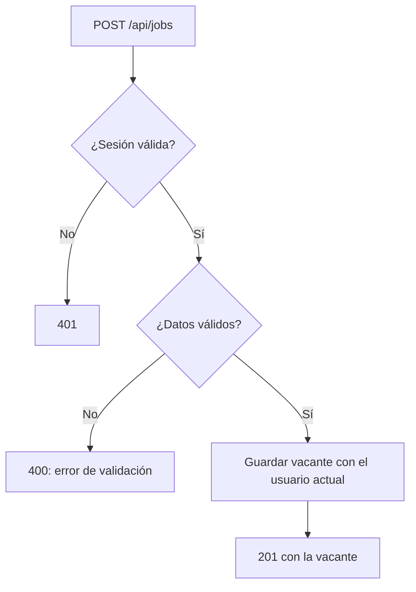

# Funcionalidad: creación de vacantes

## 1. Historia de usuario

Como usuario autenticado, quiero guardar una vacante para registrar oportunidades laborales y dar seguimiento a mi búsqueda.

Criterios de aceptación:
- `POST /api/jobs` con sesión y datos válidos responde 201 con la vacante creada.
- Puesto (`title`) y empresa (`company`) son obligatorios; si faltan, responde 400.
- Sin sesión, responde 401.
- Un enlace inválido o distinto de HTTP(S) produce 400.
- Los textos deben respetar los límites de longitud del esquema.
- Sin estado explícito, se guarda como `SAVED` y se muestra «Guardada».

Caso de error: una solicitud sin cookie se rechaza con 401.

## 2. Pseudocódigo

1. Comprobar que existe una sesión y `req.user` está disponible.
2. Leer los datos de la vacante.
3. Validar campos obligatorios, enlace, estado, fecha y límites de texto.
4. Asociar `createdBy` con el usuario actual, nunca con un valor elegido por el cliente.
5. Guardar en la base de datos.
6. Responder 201 con el registro creado.

## 3. Diagrama de flujo

## 4. Prueba de escritorio

| Paso | Operación | Caso correcto | Caso de error |
|---|---|---|---|
| 1 | Autenticar | Usuario 42 | Usuario 42 |
| 2 | Leer datos | `title: Desarrollador web`, `company: Acme` | `title: ""`, `company: Acme` |
| 3 | Validar | Correcto | 400: el puesto es obligatorio |
| 4 | Asociar usuario | `createdBy: 42` | No se ejecuta |
| 5 | Guardar | Se crea la vacante 101 | No se ejecuta |
| 6 | Responder | 201, `id: 101`, `status: SAVED` | Mensaje en español |

Otros campos disponibles: ubicación, descripción, enlace, notas, estado y fecha de postulación. Los nombres JSON permanecen en inglés por compatibilidad.
