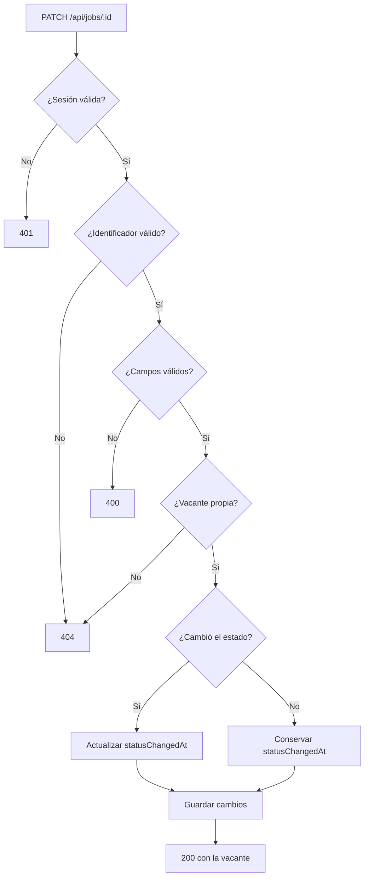

# Funcionalidad: estados, edición y eliminación de vacantes

## 1. Historia de usuario

Como persona que busca empleo, quiero cambiar el estado, editar o eliminar mis vacantes para mantener actualizado el seguimiento de mis postulaciones.

Criterios de aceptación:
- Una vacante nueva sin estado explícito se guarda como `SAVED`.
- `PATCH /api/jobs/:id` permite modificar una vacante propia; si cambia su estado, `statusChangedAt` se actualiza.
- Editar otros campos sin cambiar el estado conserva `statusChangedAt`.
- `DELETE /api/jobs/:id` elimina una vacante propia y responde 204.
- Intentar editar o eliminar una vacante ajena produce 404 sin modificarla.
- Un estado desconocido produce 400.
- Un identificador que no sea entero positivo produce 404.

Caso de error: el usuario B intenta modificar una vacante del usuario A; recibe 404 y el registro permanece igual.

Decisiones de diseño:
- Un solo modelo `Job` representa la oportunidad y su seguimiento. La tabla `Application` sin uso fue eliminada.
- Los estados internos son `SAVED`, `APPLIED`, `INTERVIEWING`, `OFFER`, `REJECTED` y `ARCHIVED`. Se muestran traducidos; se permite pasar entre cualesquiera de ellos para corregir errores.
- Los registros ajenos responden 404 para no revelar su existencia.
- `statusChangedAt` registra el último cambio; no representa un historial completo.

## 2. Pseudocódigo de actualización

1. Comprobar la sesión.
2. Leer el identificador; si no es entero positivo, responder 404.
3. Validar los campos; exigir al menos uno o responder 400.
4. Buscar por identificador y `createdBy` del usuario actual; si no existe, responder 404.
5. Si cambia el estado, actualizar `statusChangedAt`.
6. Guardar y responder 200 con la vacante actualizada.

## 3. Diagrama de flujo

## 4. Prueba de escritorio

| Paso | Operación | Caso correcto: usuario 1 | Caso de error: usuario 2 |
|---|---|---|---|
| 1 | Autenticar | `req.user.id = 1` | `req.user.id = 2` |
| 2 | Leer identificador | Vacante 7 | Vacante 7 |
| 3 | Validar cuerpo | `status: APPLIED` válido | Mismo estado válido |
| 4 | Buscar por propietario | Vacante 7 de usuario 1, estado `SAVED` | No hay coincidencia: 404 |
| 5 | Comparar estado | Cambia a `APPLIED`; actualizar fecha | No se ejecuta |
| 6 | Guardar y responder | 200; se muestra «Postulada» | La vacante sigue como `SAVED` |

Para eliminar se valida sesión e identificador, se ejecuta `deleteMany` filtrando también por propietario y se responde 204 si se eliminó un registro, o 404 si no hubo coincidencia.
