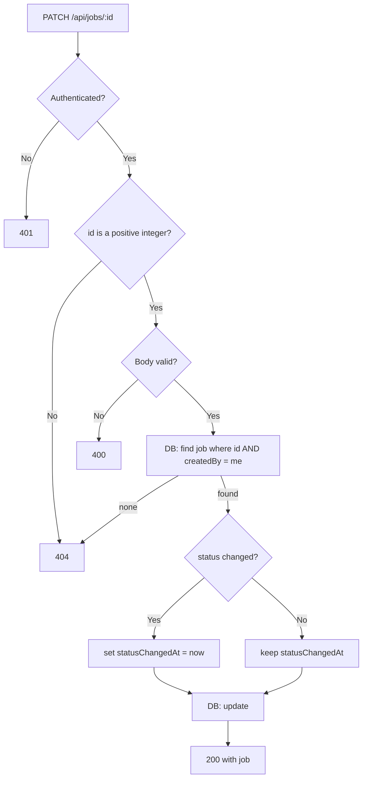

# Feature: Job status, edit and delete

1. User story
As a job seeker, I want each job to have a status that I can change, and I want to edit or delete a job, so that the list shows where every application stands today.

Acceptance criteria:
- Given a new job with no status, when I POST /api/jobs, then it is saved with status SAVED.
- Given my own job, when I PATCH /api/jobs/:id with a new status, then the status changes and statusChangedAt is set to now.
- Given my own job, when I PATCH other fields without changing status, then statusChangedAt does not change.
- Given my own job, when I DELETE /api/jobs/:id, then it is removed and the server responds with 204.
- Given a job that belongs to another user, when I PATCH or DELETE it, then the server responds with 404 and nothing changes.
- Given a status that is not in the list, when I PATCH, then the server responds with 400.
- Given an id that is not a positive integer, when I PATCH or DELETE, then the server responds with 404.

Failure case included:
- Given user B's session and the id of user A's job, PATCH responds with 404 and the job is unchanged.

Design decisions:
- One model. The unused `Application` table is dropped and `Job` carries the status. In a personal tracker a job is the application.
- Statuses: SAVED, APPLIED, INTERVIEWING, OFFER, REJECTED, ARCHIVED. Any status can move to any other; people correct mistakes.
- Another user's job answers 404, not 403, so the API does not reveal that the id exists.
- `statusChangedAt` is stored now because time-in-stage cannot be reconstructed later.

2. Pseudocode (PATCH /api/jobs/:id)
- Confirm the request is authenticated
- Parse the id from the path; if it is not a positive integer, return 404
- Validate the body; every field is optional, at least one is required; on failure return 400
- Find the job where id matches AND createdBy is the current user; if none, return 404
- If the body has a status and it differs from the stored status, set statusChangedAt to now
- Update the job and return 200 with the saved record

3. Flowchart

4. Hand trace
Inputs:
- Happy path: user 1 owns job 7 with status SAVED; user 1 sends PATCH /api/jobs/7 with { "status": "APPLIED" }
- Failure path: user 2 sends the same request

| Step | Line of pseudocode | Happy path (user 1) | Failure path (user 2) |
|---|---|---|---|
| 1 | Authenticated | req.user.id = 1 | req.user.id = 2 |
| 2 | Parse id | 7 | 7 |
| 3 | Validate body | { status: APPLIED } passes | { status: APPLIED } passes |
| 4 | Find job where id = 7 AND createdBy = me | job 7 found, status SAVED | no row, return 404 |
| 5 | Status changed? | SAVED to APPLIED, yes: statusChangedAt = now | not reached |
| 6 | Update and return | 200 { id: 7, status: APPLIED, ... } | job 7 still SAVED |
