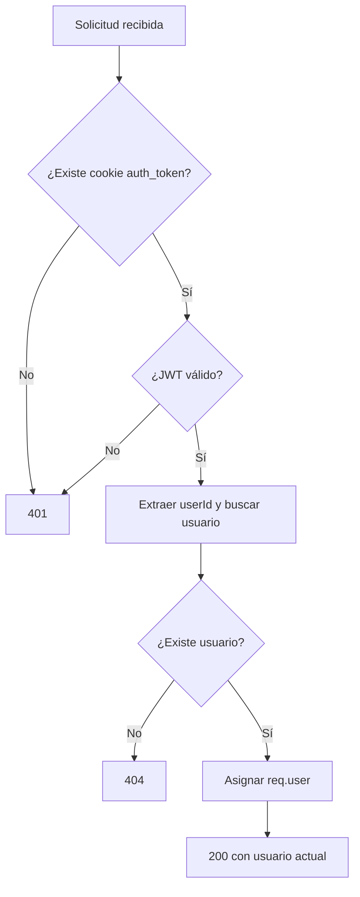

# Funcionalidad: rutas protegidas mediante JWT

## 1. Historia de usuario

Como usuario autenticado, quiero que el servidor valide mi JWT en las rutas protegidas para que solo una sesión válida permita consultar datos privados.

Criterios de aceptación:
- Una cookie válida permite consultar `GET /api/auth/me` y recibir 200 con el usuario actual.
- Sin cookie, con una sesión vencida o con un token inválido, responde 401.
- Un token de un usuario que ya no existe produce 404.

Caso de error: JWT inválido → 401 con mensaje en español.

## 2. Pseudocódigo

1. Leer la cookie `auth_token`.
2. Si falta, responder 401.
3. Verificar firma y vencimiento con la clave de la aplicación.
4. Si la verificación falla, responder 401.
5. Extraer `userId` y buscar al usuario.
6. Si no existe, responder 404.
7. Agregar el usuario a `req.user` y continuar.
8. Responder con el resumen del usuario desde la ruta protegida.

## 3. Diagrama de flujo

## 4. Prueba de escritorio

| Paso | Operación | Caso correcto | Caso de error |
|---|---|---|---|
| 1 | Leer cookie | Token válido | Sin cookie: 401 |
| 2 | Verificar JWT | Contiene `userId: 42` | No se ejecuta |
| 3 | Buscar usuario | Usuario 42 encontrado | No se ejecuta |
| 4 | Asignar `req.user` | Datos públicos del usuario | No se ejecuta |
| 5 | Responder | 200 con `id`, `email` y `name` | Debes iniciar sesión |

Estos valores son ejemplos para la prueba de escritorio, no credenciales reales.
