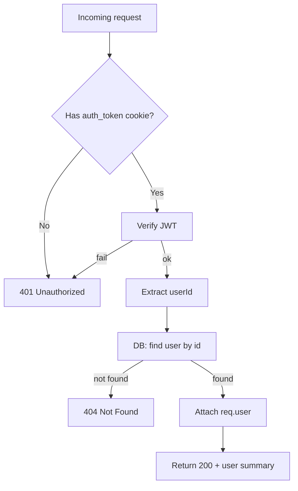

# Feature: JWT-Protected Route

1. User story
As an authenticated user, I want the backend to validate my JWT on protected routes so that only logged-in users can access private data.

Acceptance criteria:
- Given a valid JWT cookie, when I GET /api/auth/me, then the server responds with 200 and the user summary.
- Given no cookie, when I GET /api/auth/me, then the server responds with 401 Unauthorized.
- Given an expired or malformed token, when I GET /api/auth/me, then the server responds with 401.
- Given a token for a user that no longer exists, when I GET /api/auth/me, then the server responds with 404.

Failure case included:
- Given an invalid JWT, the server rejects with 401.

2. Pseudocode
- Read the auth_token cookie from the request
- If the cookie is missing, return 401
- Verify the JWT using the app secret
- If verification fails, return 401
- Extract the userId from the token payload
- Fetch the user record from the database by id
- If the user does not exist, return 404
- Attach the user to req.user and continue
- Return the user summary from the protected route handler

3. Flowchart

4. Hand trace
Inputs:
- Happy path: cookie token = ______
- Failure path: no cookie

| Step | Line of pseudocode | Variable values | Output |
|---|---:|---|---|
| 1 | Read cookie | req.cookies.auth_token | token or undefined |
| 2 | Verify JWT | token | payload or error |
| 3 | Find user by id | payload.userId | user / null |
| 4 | Attach req.user | user | next() |
| 5 | Return | req.user | 200 response |

Answer key (happy path example)

Example:
- Cookie contains a valid token with payload { userId: 42 }
- DB returns user { id: 42, email: "bob@example.com", name: "Bob" }
- req.user is attached
- Protected route returns 200 { id: 42, email: "bob@example.com", name: "Bob" }

Failure:
- no cookie -> 401 Unauthorized

