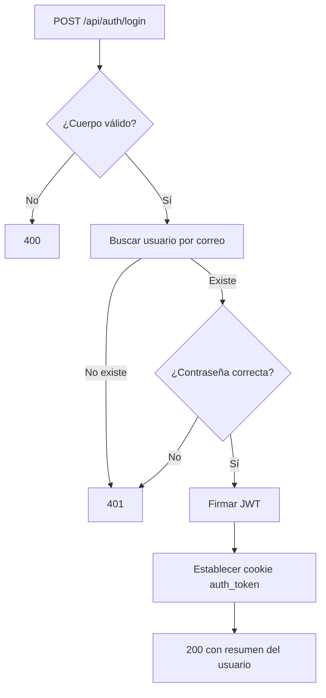

# Funcionalidad: inicio de sesión

## 1. Historia de usuario

Como usuario registrado, quiero iniciar sesión con mi correo y contraseña para acceder a mis datos mediante una cookie JWT `httpOnly`.

Criterios de aceptación:
- Con credenciales válidas, `POST /api/auth/login` responde 200 y establece la cookie JWT.
- Con correo o contraseña incorrectos, responde 401.
- Con un cuerpo inválido, responde 400.
- Sin cookie, una ruta protegida responde 401.

Caso de error: una contraseña incorrecta produce 401 con un mensaje en español.

## 2. Pseudocódigo

1. Leer `{ email, password }` y validar los campos.
2. Buscar al usuario por correo; si no existe, responder 401.
3. Verificar la contraseña con el resumen criptográfico Argon2 almacenado.
4. Si no coincide, responder 401.
5. Crear un JWT con el identificador del usuario y su duración.
6. Establecer la cookie `httpOnly`.
7. Responder 200 con el usuario, sin incluir su contraseña ni su resumen criptográfico.

## 3. Diagrama de flujo

## 4. Prueba de escritorio

Entrada correcta: `email = bob@example.com`, `password = Secur3P@ss!`; existe el usuario 42 con esa contraseña.
Entrada incorrecta: el mismo correo con `password = incorrecta`.

| Paso | Operación | Caso correcto | Caso de error |
|---|---|---|---|
| 1 | Validar campos | Formato válido | Formato válido |
| 2 | Buscar usuario | Usuario 42 | Usuario 42 |
| 3 | Verificar contraseña | Coincide | No coincide: 401 |
| 4 | Crear JWT | Incluye `userId: 42` | No se ejecuta |
| 5 | Establecer cookie | `auth_token`, `HttpOnly`, `SameSite=Lax` | No se ejecuta |
| 6 | Responder | 200 con `id`, `email` y `name` | Correo o contraseña incorrectos |

El atributo `Secure` se activa en producción. Los ejemplos son datos ficticios.
