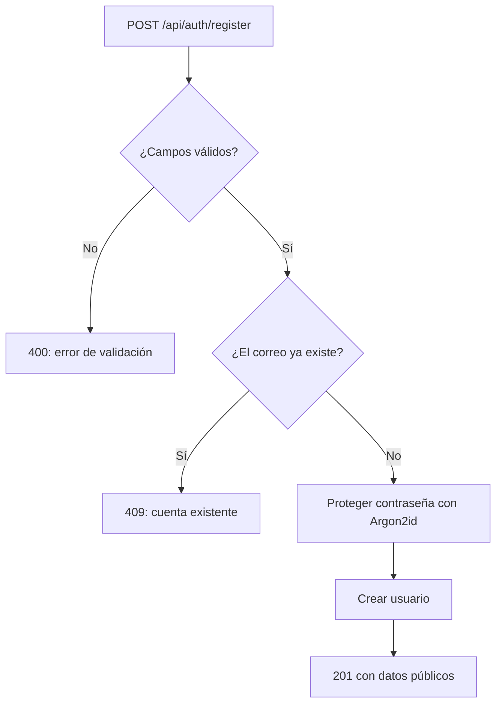

# Funcionalidad: registro de cuenta

## 1. Historia de usuario

Como persona que busca empleo, quiero crear una cuenta con correo y contraseña para guardar y administrar mis postulaciones.

Criterios de aceptación:
- Un correo válido y una contraseña de al menos ocho caracteres permiten crear una cuenta mediante `POST /api/auth/register`; responde 201 con datos del usuario, sin contraseña.
- Un correo ya registrado produce 409.
- Una contraseña demasiado corta, campos obligatorios ausentes o datos inválidos producen 400.

Caso de error: un correo ya utilizado se rechaza con 409 y un mensaje en español.

## 2. Pseudocódigo

1. Leer `{ email, password, name? }`.
2. Validar correo, longitud de contraseña y nombre opcional.
3. Consultar si existe el correo; si existe, responder 409.
4. Proteger la contraseña con Argon2id.
5. Guardar el usuario en la base de datos.
6. Responder 201 con sus datos públicos.

## 3. Diagrama de flujo

## 4. Prueba de escritorio

| Paso | Operación | Caso correcto | Caso de error |
|---|---|---|---|
| 1 | Leer entrada | `bob@example.com`, `Secur3P@ss!`, `Roberto` | Mismo correo, contraseña `corta` |
| 2 | Validar | Correcto | 400: contraseña de menos de ocho caracteres |
| 3 | Buscar correo | No existe | No se ejecuta |
| 4 | Proteger contraseña | Se genera el resumen criptográfico | No se ejecuta |
| 5 | Guardar | Nuevo usuario con `id: 42` | No se ejecuta |
| 6 | Responder | 201 con `id`, `email` y `name` | Mensaje de validación en español |

Si el correo ya existe y la entrada es válida, el paso 3 responde 409. El problema previo del nombre enviado como cadena vacía sigue en el plan M2; traducir su mensaje no cambia esa regla.
