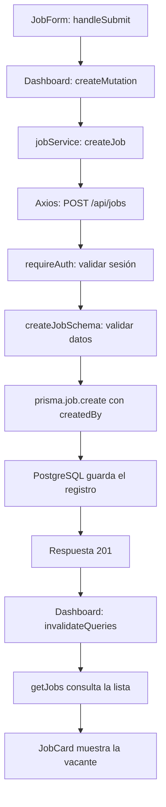

# Mapa del proyecto: qué contiene cada carpeta y por qué

Este documento sirve como directorio para ubicar una explicación o decidir dónde trabajar. Las rutas y los símbolos mencionados corresponden a la versión actual; los archivos propuestos para tareas futuras se señalan como nuevos.

Si una palabra es nueva, consulta el [glosario](glosario-y-diseno.md). Para justificar las herramientas, consulta las [decisiones técnicas](decisiones-tecnicas.md).

## Vista general

```text
/
├── frontend/          Pantallas y comunicación desde el navegador
│   └── src/
│       ├── pages/     Pantallas completas
│       ├── components/ Partes reutilizables
│       ├── services/  Solicitudes a la API
│       ├── lib/       Auxiliares y consulta de sesión
│       ├── types/     Formas esperadas de los datos
│       └── styles/    Entrada de estilos
├── backend/           Reglas del servidor y acceso a datos
│   ├── src/
│   │   ├── routes/    Operaciones de la API
│   │   ├── middleware/ Comprobación de sesión
│   │   ├── lib/       Validación de entradas
│   │   └── config/    Configuración del entorno
│   └── prisma/
│       └── migrations/ Cambios históricos de la base
├── api/               Entrada del servidor para Vercel
├── docs/              Explicaciones y evidencia
│   ├── features/      Diseño de funcionalidades
│   ├── setup/         Instalación y operación
│   └── sessions/      Bitácoras de trabajo
└── .github/           Plantilla de solicitudes de cambios
```

## Raíz: configuración que une el proyecto

| Archivo | Qué contiene y por qué existe | Cuándo se modifica |
|---|---|---|
| [README.md](../README.md) | Introducción accesible y alcance | Al cambiar el propósito, estado o explicación general |
| [PLAN.md](../PLAN.md) | Etapas, preguntas, lugares de trabajo y criterios de cierre | Al decidir prioridades o registrar avance comprobado |
| [AGENTS.md](../AGENTS.md) | Convenciones de idioma y documentación | Al acordar prácticas del proyecto |
| [package.json](../package.json) | Dos espacios de trabajo y comandos raíz | Al agregar herramientas o comandos compartidos |
| [package-lock.json](../package-lock.json) | Versiones resueltas para repetir instalaciones | Lo actualiza npm al cambiar dependencias; no se edita como prosa |
| [.nvmrc](../.nvmrc) | Versión de Node de referencia | Al actualizar y verificar el entorno |
| [.gitignore](../.gitignore) | Exclusiones de secretos, dependencias y archivos generados | Al introducir un archivo local que no debe publicarse |
| [tsconfig.json](../tsconfig.json) | Revisión de tipos de la entrada `api/` | Al cambiar esa compilación o sus archivos incluidos |
| [docker-compose.yml](../docker-compose.yml) | Servicio PostgreSQL local y volumen de datos | Al cambiar la configuración local de la base |
| [vercel.json](../vercel.json) | Compilación, salida de interfaz y redirección de solicitudes | Al cambiar cómo se publica la aplicación |

## frontend/: lo que utiliza la persona

Separar pantallas, componentes y solicitudes evita que un cambio de aspecto obligue a reescribir el acceso a la API.

| Archivo | Responsabilidad y símbolos importantes | Cuándo revisarlo |
|---|---|---|
| [index.html](../frontend/index.html) | Documento `es-MX`, título y elemento `root` | Idioma o metadatos de la página |
| [src/main.tsx](../frontend/src/main.tsx) | `createRoot`, `BrowserRouter` y `QueryClientProvider` inician la interfaz | Configuración global de navegación o consultas |
| [src/App.tsx](../frontend/src/App.tsx) | Relaciona `/login`, `/register` y `/` con sus pantallas | Agregar o cambiar una página |
| [pages/LoginPage.tsx](../frontend/src/pages/LoginPage.tsx) | Inicio de sesión, `handleSubmit`, correo y contraseña | Acceso, mensajes o enlaces de navegación |
| [pages/RegisterPage.tsx](../frontend/src/pages/RegisterPage.tsx) | Registro, `handleSubmit`, nombre opcional | Campos de cuenta y tratamiento de nombre vacío |
| [pages/Dashboard.tsx](../frontend/src/pages/Dashboard.tsx) | Lista, `changeStatus`, `removeJob`, `refreshJobs`, consultas y mutaciones | Filtros, conteos, acciones y actualización de lista |
| [components/ProtectedRoute.tsx](../frontend/src/components/ProtectedRoute.tsx) | Usa `useAuth` y redirige a `/login` | Acceso visual a pantallas protegidas; no sustituye la protección del servidor |
| [components/JobCard.tsx](../frontend/src/components/JobCard.tsx) | Tarjeta, selector de estado, fechas, editar y eliminar | Presentación de una vacante y ayudas de accesibilidad |
| [components/JobForm.tsx](../frontend/src/components/JobForm.tsx) | `initialValues`, `handleChange`, `handleSubmit`; sirve para crear y editar | Campos, etiquetas y límites del formulario |
| [services/authService.ts](../frontend/src/services/authService.ts) | `registerUser`, `loginUser`, `logoutUser`, `getCurrentUser` | Contrato de solicitudes de autenticación |
| [services/jobService.ts](../frontend/src/services/jobService.ts) | `getJobs`, `createJob`, `updateJob`, `deleteJob` | Contrato de operaciones de vacantes |
| [lib/api.ts](../frontend/src/lib/api.ts) | Instancia Axios con `withCredentials: true` | Configuración de solicitudes; usa rutas relativas |
| [lib/useAuth.ts](../frontend/src/lib/useAuth.ts) | `useQuery` con clave `['me']` | Lectura y comportamiento de la sesión en la interfaz |
| [lib/errors.ts](../frontend/src/lib/errors.ts) | `getErrorMessage` interpreta errores individuales o listas | Presentar fallas de API o conexión |
| [lib/dates.ts](../frontend/src/lib/dates.ts) | `toDateInputValue` y `formatCalendarDate` | Fechas de postulación sin desplazamiento de día |
| [types/auth.ts](../frontend/src/types/auth.ts) | `User`, `RegisterRequest`, `LoginRequest` | Propiedades esperadas de cuentas y solicitudes |
| [types/job.ts](../frontend/src/types/job.ts) | `Job`, `JobInput`, `JobStatus`, `STATUS_LABELS` | Propiedades de vacantes y traducción de estados |
| [styles/index.css](../frontend/src/styles/index.css) | Capas base, componentes y utilidades de Tailwind | Estilos generales |

Las rutas de esta tabla bajo `pages/`, `components/`, `services/`, `lib/`, `types/` y `styles/` pertenecen a `frontend/src/`.

| Configuración de frontend | Propósito |
|---|---|
| [package.json](../frontend/package.json) | Dependencias de la interfaz y comandos Vite/TypeScript |
| [tsconfig.json](../frontend/tsconfig.json) | Revisión estricta de TS/TSX sin emitir JavaScript junto al código fuente |
| [vite.config.ts](../frontend/vite.config.ts) | Complemento React y reenvío local de `/api` al puerto 4000 |
| [tailwind.config.cjs](../frontend/tailwind.config.cjs) | Archivos que Tailwind analiza y tema visual predeterminado |
| [postcss.config.cjs](../frontend/postcss.config.cjs) | Procesamiento CSS con Tailwind y Autoprefixer |
| [src/vite-env.d.ts](../frontend/src/vite-env.d.ts) | Referencia a tipos de Vite; no contiene reglas de negocio |

## backend/: reglas que no deben depender del navegador

| Archivo | Responsabilidad y símbolos importantes | Cuándo revisarlo |
|---|---|---|
| [src/app.ts](../backend/src/app.ts) | `express()`, JSON, cookies, rutas, respuestas 404/500 | Manejo común de solicitudes, registro de eventos y errores |
| [src/server.ts](../backend/src/server.ts) | `app.listen` inicia el servidor local | Arranque y puerto; la función de Vercel usa otra entrada |
| [src/db.ts](../backend/src/db.ts) | Instancia de `PrismaClient` | Acceso compartido a la base de datos |
| [src/config/env.ts](../backend/src/config/env.ts) | Carga y valida `DATABASE_URL`, `JWT_SECRET`, duración y puerto | Configuración, errores de arranque y pruebas de entorno |
| [src/middleware/auth.ts](../backend/src/middleware/auth.ts) | `requireAuth`, `jwt.verify`, búsqueda de usuario y `req.user` | Sesión inválida, vencida o ausente |
| [src/routes/auth.ts](../backend/src/routes/auth.ts) | Registro, sesión, Argon2, JWT y selección de datos públicos | Normalización de correo, credenciales y cookie |
| [src/routes/jobs.ts](../backend/src/routes/jobs.ts) | GET/POST/PATCH/DELETE; `createdBy` en consultas | Autorización, filtros del servidor y actualización de estado |
| [src/lib/validation.ts](../backend/src/lib/validation.ts) | `registerSchema`, `loginSchema`, `createJobSchema`, `updateJobSchema`, `parseId` | Reglas de entrada y mensajes de error |
| [prisma/schema.prisma](../backend/prisma/schema.prisma) | Modelos `User`, `Job` y enumeración `JobStatus` | Agregar o cambiar datos persistidos; requiere planear migración |
| [prisma/seed.ts](../backend/prisma/seed.ts) | `main`, `upsert`, `deleteMany`, `createMany` preparan ejemplos | Datos de demostración; reemplaza vacantes de esa cuenta |
| [prisma/migrations/](../backend/prisma/migrations) | Migración inicial, cambio de estados y archivo de bloqueo del proveedor | Agregar una migración nueva, sin reescribir las ya aplicadas |
| [.env.example](../backend/.env.example) | Nombres y valores de ejemplo para arrancar localmente | Documentar configuración sin publicar secretos reales |
| [package.json](../backend/package.json) | Dependencias y comandos de servidor/Prisma | Herramientas, pruebas y ejecución |
| [tsconfig.json](../backend/tsconfig.json) | Compilación de `src/` hacia `dist/` | Cambios de configuración TypeScript del servidor |

## api/, .github/ y docs/

| Lugar | Qué contiene y por qué |
|---|---|
| [api/index.ts](../api/index.ts) | Entrada para Vercel que reutiliza la aplicación Express |
| [.github/pull_request_template.md](../.github/pull_request_template.md) | Lista de revisión de solicitudes de cambios; todavía no hay un flujo de integración continua |
| [docs/features/](features) | Diseño por funcionalidad: historia, pseudocódigo, diagrama y prueba de escritorio antes de implementar |
| [docs/setup/](setup) | Guía operativa vigente y plan histórico de instalación |
| [docs/sessions/](sessions) | Evidencias y límites de cada sesión; no se reescriben para simular avances posteriores |
| [docs/glosario-y-diseno.md](glosario-y-diseno.md) | Definiciones, significado de claves históricas y tipografía |
| [docs/decisiones-tecnicas.md](decisiones-tecnicas.md) | Necesidad, elección tecnológica, código real y alternativas |

`node_modules/` contiene dependencias instaladas, `dist/` resultados de compilación y `backend/.env` configuración local. No son documentación ni código que deba editarse para implementar funciones; se excluyen del repositorio. `.git/` es información de control de versiones.

## Recorrido real: guardar una vacante



Este es el recorrido definido por el código, no una afirmación de que ya se verificó íntegramente con una base real en la última sesión. Los pasos de error y de rechazo de sesión están en los documentos de funcionalidades.

## Guía rápida para decidir dónde cambiar algo

| Necesidad | Primer lugar que revisar | Qué más debe coincidir |
|---|---|---|
| Cambiar un texto o tamaño visual | Pantalla o componente correspondiente | Glosario, idioma y accesibilidad |
| Añadir un campo guardado | Modelo Prisma y documento de funcionalidad | Migración, Zod, tipos, formulario, servicio y tarjeta |
| Añadir un filtro visual | `Dashboard.tsx` | Decidir si filtra la lista descargada o consulta al servidor |
| Cambiar una regla de entrada | `backend/src/lib/validation.ts` | Formulario, contrato y casos de prueba |
| Corregir acceso a datos ajenos | Middleware y consultas de `routes/jobs.ts` | Pruebas de API con dos usuarios |
| Agregar pruebas automáticas | Nuevas carpetas y comandos definidos en el plan | Base de pruebas y flujo de integración continua |
